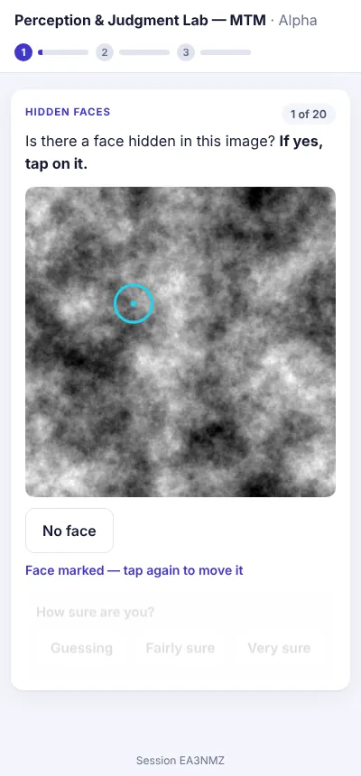
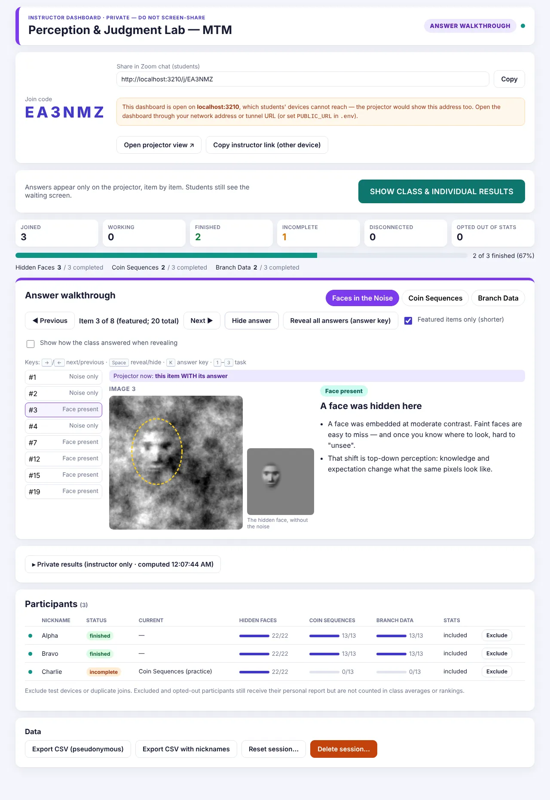
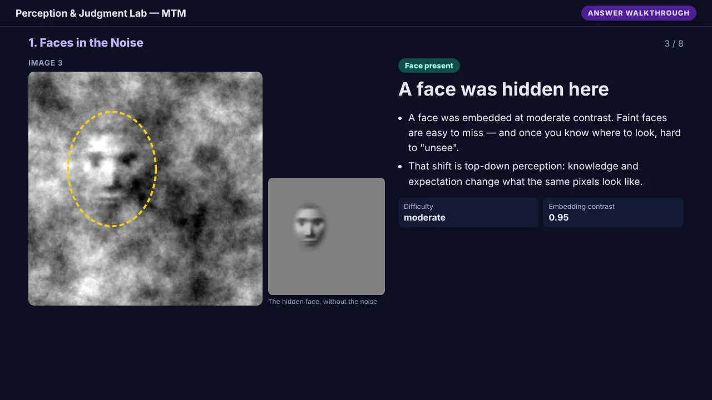

# Apophenia Perception Lab

A live, multi-device web application for a 30-minute **Management Teaching Methods** class on Zoom. Students make genuine perceptual and data judgments without knowing the concept being demonstrated. The instructor then introduces **apophenia** and runs a controlled reveal. Answers, scores and class statistics are released **only** when the instructor says so.

| Students (phone or laptop) | Instructor (private) | Projector (screen-shared in Zoom) |
|---|---|---|
|  |  |  |

**The battery** (about 8 minutes; rationale in [docs/DESIGN.md](docs/DESIGN.md), literature in [docs/RESEARCH.md](docs/RESEARCH.md)):

1. **Faces in the Noise.** Classroom adaptation of the Noise Pareidolia Test (Yokoi et al., 2014; Mamiya et al., 2016). Find faint faces in visual noise: 5 of 20 images contain one.
2. **Coin Sequences.** Fair coin or hidden rule? Six genuinely random sequences and six from known rule-governed coins (Falk & Konold, 1997; van Prooijen et al., 2018).
3. **Branch Data.** Is the relationship real? Four planted relationships, four independent datasets, and four independent datasets cherry-picked as the most striking of 100. Each comes with a 300-branch replication for the reveal.

Every task is scored on its own signal-detection terms (hits, misses, false alarms, correct rejections, d′, confidence). There is **no overall "apophenia score"**, and the app makes no claims about personality, intelligence or mental health.

---

## Contents

1. [How the class runs (phases)](#1-how-the-class-runs)
2. [Windows setup (local)](#2-windows-setup)
3. [Getting a shareable HTTPS URL](#3-getting-a-shareable-https-url)
4. [Class-day runbook](#4-class-day-runbook)
5. [Rehearsal checklist (multi-device)](#5-rehearsal-checklist)
6. [Recovering from problems](#6-recovering-from-problems)
7. [Configuration](#7-configuration)
8. [Development, tests and project structure](#8-development-and-tests)
9. [Documentation index](#9-documentation-index)

---

## 1. How the class runs

The session state is stored on the server and changes **only** when the instructor clicks a control. Students finishing does **not** advance anything.

| Phase | Instructor control | Student screen | Projector |
|---|---|---|---|
| A. Lobby | create session; share link | join → "waiting for the instructor" | join code, joined count |
| B. Testing | **OPEN TEST** | tasks (no feedback) → *"You've completed all the activities. Please wait while the rest of the class finishes."* | live counts and per-task completion |
| C. Locked | **CLOSE TEST & LOCK RESPONSES** | *"Your responses have been submitted. The activity is now closed. The instructor will discuss the phenomenon and reveal the results shortly. Please keep this page open."* | "Responses locked" |
| D. Debrief | (your slides) | waiting screen | waiting |
| E. Walkthrough | **BEGIN ANSWER WALKTHROUGH**, then Previous / Next / Reveal / full answer key | still the waiting screen | one item at a time; answers only when revealed; **no scores** |
| F. Results | **SHOW CLASS & INDIVIDUAL RESULTS** | personal report: own scores beside the class average (n shown) | class-level charts |
| G. Rankings (optional) | choose task + metric + mode → Show / Hide | — | the selected rows only, metric and direction stated |
| H. Discussion & close | discussion questions → conclusion → **Close & archive** | report stays available | questions / conclusion |

Details: [docs/SECURITY.md](docs/SECURITY.md) (state machine and who can see what).

---

## 2. Windows setup

You need **Node.js 22 LTS** (22.13 or newer) and **Git**.

1. Install Node.js 22 LTS from <https://nodejs.org> (Windows Installer, default options). Install Git from <https://git-scm.com/download/win>.
2. Open **PowerShell** and run:

   ```powershell
   git clone https://github.com/Sour-abh-Raj/apophenia-demo.git
   cd apophenia-demo
   npm install
   npm run build
   copy .env.example .env
   notepad .env
   ```

3. In Notepad, set your own passcode, for example `INSTRUCTOR_PASSCODE=my-secret-passcode`, then save and close.
4. Start the server:

   ```powershell
   npm start
   ```

   You should see `Apophenia Perception Lab listening on http://localhost:3000`. If Windows Firewall asks, allowing **private networks** is enough.
5. Open <http://localhost:3000/host> in Chrome or Edge, enter your passcode, and click **Create session**.

The database is a single file, `data\lab.sqlite`. It is created automatically, and migrations run automatically at start-up. Stimuli are already in `stimuli\`, so nothing needs to be downloaded. To stop the server, press `Ctrl+C` in PowerShell.

> Optional: to regenerate the stimuli you also need Python 3 with `pip install numpy pillow`. Run `npm run generate:battery` and `py scripts\stimuli\generate_faces.py`. The output is byte-identical to the committed files.

---

## 3. Getting a shareable HTTPS URL

Students need a public **https://** address that works from any network. There are two options.

### Option A (recommended): Render, free

Render runs the app exactly as it runs on your laptop and gives it a permanent address that works for students anywhere in the world. In the Render dashboard click **New +** → **Web Service**, pick the `apophenia-demo` repository, and fill in the form like this:

| Field | Value |
|---|---|
| Name | `perception-lab` (students see it in the address — keep it neutral; "apophenia" would give the concept away) |
| Project | leave empty |
| Language | **Docker** |
| Branch | **`main`** |
| Region | the one closest to most of your students (Singapore is fine for South/South-East Asia; students elsewhere still work) |
| Root Directory | leave empty |
| Instance type | **Free** |
| Environment Variables | add **`INSTRUCTOR_PASSCODE`** = the passcode you'll type on the instructor page. Nothing else is needed (the port and public address are detected automatically). |
| Health Check Path | **`/api/health`** |
| Docker Build Context Directory | `.` |
| Dockerfile Path | **`./Dockerfile`** |
| Docker Command / Pre-Deploy Command | leave empty |
| Auto-Deploy | On Commit |
| Build Filters → Ignored Paths | optional: `docs/**`, `README.md`, `tests/**` (documentation changes then won't restart the server) |

Click **Deploy Web Service**. The first build takes about 3–5 minutes; when the log shows `listening on`, open `https://<your-service>.onrender.com/host`. (Alternatively, **New +** → **Blueprint** reads the same settings from `render.yaml`.)

What the free plan means for class day:

- **Free hours are shared per workspace** (750 instance-hours a month across all your free services). If other free services in the same workspace stay awake all month, this one can be suspended when the pool runs out — check *Billing → Free usage* before class.
- **It sleeps** after about 15 minutes without visits. The first visit afterwards takes 30–60 seconds while it wakes. **Open the site about 5 minutes before class** (the dashboard or the home page); once students are on it, it stays awake.
- **Its disk is temporary.** Sessions and answers survive while the server is running, but are erased when it restarts or redeploys. So: create the session on class day (not the day before), **don't push code to GitHub during class** (every push redeploys), and **export the CSV right after class**. For permanent storage, switch to a paid instance with a disk and set `DATABASE_PATH` to a file on it.
- Updates: every push to `main` redeploys automatically.

Why not Vercel? Vercel runs code as short-lived serverless functions without a shared disk or long-lived connections. This app keeps one live session state, a database and an open connection to each student's screen, so on Vercel it would need an external database and a rewrite of the live updates. Render needs none of that.

### Option B: your laptop + Cloudflare Tunnel (free, no account)

Useful for rehearsing, or if Render is unavailable.

1. Install cloudflared once, in PowerShell: `winget install --id Cloudflare.cloudflared`. Then close and reopen PowerShell.
2. With `npm start` running in one PowerShell window, run this in a second window:

   ```powershell
   cloudflared tunnel --url http://localhost:3000
   ```

3. It prints a URL such as `https://something-random.trycloudflare.com`. Put it in `.env` as `PUBLIC_URL=https://something-random.trycloudflare.com` (then restart `npm start`), or simply open the dashboard on **that** URL so the join links and QR code use it.
4. Keep both windows open and stop your laptop from sleeping during class (Settings → System → Power).

The quick-tunnel URL changes every time you restart cloudflared. For classes larger than about 60 students, add `DISABLE_SSE=1` to `.env` (polling-only updates), because quick tunnels limit concurrent connections.

---

## 4. Class-day runbook

| Step | What to do | Where |
|---|---|---|
| 1 | Start the server (and the tunnel, Option A). Open `https://<your-url>/host`, enter the passcode, **Create session**. Bookmark the dashboard. | Instructor browser |
| 2 | Click **Open projector view ↗**. Arrange that window for screen sharing. In Zoom: *Share screen → that browser window* (**never** share the dashboard). | Projector window |
| 3 | Paste the student link `https://<your-url>/j/<CODE>` (the **Copy** button on the dashboard) into the Zoom chat. The code is also shown large on the projector. | Zoom chat |
| 4 | When people have joined, click **OPEN TEST** → confirm. | Dashboard |
| 5 | Watch *Joined / Taking test / Finished / Not finished yet / Disconnected*. Ask *"Has everyone finished?"* | Dashboard |
| 6 | Click **CLOSE TEST & LOCK RESPONSES** → confirm. The dialog lists anyone who has not finished. Their completed activities are kept; unfinished activities are excluded from class averages. | Dashboard |
| 7 | Introduce apophenia with your slides. Students stay on the waiting screen. (Mis-locked? **Re-open test** works until the walkthrough starts.) | Your slides |
| 8 | Click **BEGIN ANSWER WALKTHROUGH**. Pick a task tab, use **Next / Previous**, and click **Reveal answer** when ready. Every item starts hidden, and moving to any other item (or back from the answer key) hides it again. Your dashboard mirrors the projector and shows the answer privately in a separate "Only you can see this" box. Untick *Featured items only* to browse every item; **Reveal all answers (answer key)** shows the whole task at once. | Dashboard → projector |
| 9 | Click **SHOW CLASS & INDIVIDUAL RESULTS** → confirm. Students see their reports; the projector shows class results. Click the projector's tabs (Overview, Faces, Coins, Branch Data, Confidence) **in the projector window**. | Dashboard + projector window |
| 10 | Optional rankings: choose task, metric (its direction is shown) and mode → **Preview privately** or **Show on projector**; **Hide rankings** removes them. | Dashboard |
| 11 | **Discussion questions** (◀ ▶ to move), then **Conclusion**, then **Close & archive session**. | Dashboard |
| 12 | Afterwards: **Export CSV** (pseudonymous), then **Delete session** if you do not need the data. | Dashboard |

Which URL goes where:

- **Instructor (private):** `https://<your-url>/host/<session-id>`. On another device, use **Copy instructor link**: it contains the key, so treat it like a password.
- **Projector (screen-share):** opened by the **Open projector view** button (`/screen/<session-id>?k=…`).
- **Students:** `https://<your-url>/j/<CODE>`, or the home page plus the 6-letter code.

---

### New in this version

- **Concealment:** before the walkthrough, nothing a student or the projector shows names or hints at the concept. Task 1 is called *Hidden Faces* until the debrief. The default session title is neutral, and the create form warns if your title gives the concept away. `tests/unit/concealment.test.ts` and the e2e test enforce this.
- **Message to students** (while testing): send a "2 minutes left" banner to every student's screen.
- **Guesses while waiting:** finished students guess how many images had a face and how many charts were real. Projector and reports compare the guesses with the truth after release.
- **Walkthrough:** keyboard shortcuts (→/← move, Space reveal, K answer key, 1–3 task) and an optional *Show how the class answered* line on each revealed item (aggregate only).
- **Results:** the Overview leads with the key contrasts (cherry-picked vs ordinary charts, repeating vs switching coins). Student reports open with a plain-language summary; d′ is under *Details*.
- **Rankings:** *Preview privately* now never changes the projector.
- **Data:** excluded devices are left out of all counts. Optional research consent and the guesses are included in the CSV.

## 5. Rehearsal checklist

Do a full rehearsal a day before class, with your phone and one or two other devices or people:

1. Create a session called "Rehearsal". Open the projector view.
2. Join from your phone (mobile data, not Wi-Fi, if possible) and from a second laptop/browser profile. Each device gets its own identity.
3. **Open test**; complete everything on one device. Check it shows the waiting message and that the dashboard counts update.
4. On another device, answer a few items, **refresh the page**, and check it resumes on the same item. Leave it unfinished.
5. **Lock**; check all devices show the "submitted" screen.
6. **Begin walkthrough**; reveal a few items. Check the student devices are still waiting.
7. **Show results**; check each device's report and the class averages (n). Try a ranking.
8. **Reset session** (type RESET) to clear the rehearsal, or create a fresh session for class.
9. Check the faint faces are visible but hard on your actual projector/Zoom setup.

---

## 6. Recovering from problems

| Problem | What to do |
|---|---|
| A student closed the tab / phone locked / Wi-Fi dropped | They reopen the same link on the **same device and browser**. Their identity is stored in that browser and they resume where they left off; nothing is duplicated. The dashboard shows them as disconnected meanwhile. |
| A student switched devices or used a private window | They cannot resume the old identity. They can rejoin as a new participant before you lock (use **Exclude** on the abandoned entry), or watch the projector. |
| Your dashboard tab closed | Reopen `/host` → the session is listed under "Sessions on this browser"; or use the copied instructor link. |
| Projector window closed | **Open projector view ↗** again. It always shows the current server state. |
| The server or laptop restarted (laptop) | Run `npm start` (and the tunnel) again. All data and the current phase are in `data/lab.sqlite`. If the tunnel URL changed, share the new link; students' identities are tied to the old address, so ask anyone mid-test to rejoin. |
| The Render server restarted (free plan) | The dashboard says "This session no longer exists": the temporary disk was cleared. Create a new session and share the new code; students rejoin. This is why you shouldn't push code during class. |
| The site takes ~1 minute to open | The free Render server was asleep and is waking up. Wait; it then stays fast while people use it. |
| You locked too early | **Re-open test** (only before the walkthrough). |
| A test device or duplicate joined | **Exclude** in the participants table. Excluded people are kept out of averages and rankings, and aggregates are recomputed. |
| Live updates seem stuck (corporate network/proxy) | Pages also poll every 4–6 s, so they still update. You can force polling-only with `DISABLE_SSE=1`. |

---

## 7. Configuration

| Variable | Default | Meaning |
|---|---|---|
| `INSTRUCTOR_PASSCODE` | *(random, printed at start-up)* | Required to create sessions. Set it in `.env` or your host's dashboard. **Never commit it.** |
| `PORT` | `3000` | HTTP port |
| `DATABASE_PATH` | `data/lab.sqlite` | SQLite file (must be on persistent storage when deployed) |
| `PUBLIC_URL` | *(on Render: detected automatically; otherwise the address the dashboard is open on)* | Address students use, e.g. `http://192.168.1.20:3000` or your tunnel URL. Shown on the projector (with a QR code) and in the join link. |
| `DISABLE_SSE` | *(off)* | `1` = polling-only live updates (for connection-limited tunnels) |
| `STIMULI_DIR` | `stimuli` | Location of stimulus files and answer keys |
| `CLIENT_DIR` | `dist/client` | Built web client |

`.env` in the project folder is loaded automatically. `.env` and `data/` are git-ignored.

---

## 8. Development and tests

```bash
npm install
npm run dev          # API on :3000 + Vite dev server on :5173 (open http://localhost:5173)
npm run typecheck
npm test             # unit, stimulus-integrity and API-security tests (Vitest)
npm run build && npm run test:e2e   # full class in real browsers (Playwright/Chromium)
```

Test record: [docs/TEST_RESULTS.md](docs/TEST_RESULTS.md).

```
src/shared/      state machine, scoring (signal detection, rankings), statistics, seeded RNG, types
src/server/      Express API, SQLite + migrations, SSE hub, battery loader, results snapshot
src/client/      React app: participant flow, instructor dashboard, projector, report
scripts/         stimulus generators (seeded, reproducible)
stimuli/         generated images + answer-key manifests (server-side only)
tests/unit/      Vitest: scoring, state machine, stimuli, API security
tests/e2e/       Playwright: instructor + projector + 3 participants, full flow
docs/            research review, design rationale, security, limitations, test results, screenshots
```

Stack: Node 22 (built-in `node:sqlite`), Express, React 19 + Vite, Server-Sent Events. There are no external services, no analytics, and no runtime calls to third parties.

---

## 9. Documentation index

- [docs/RESEARCH.md](docs/RESEARCH.md): literature review, paradigm comparison, reference list (with verification notes)
- [docs/DESIGN.md](docs/DESIGN.md): final battery, generating processes, scoring rules, run of show
- [docs/SECURITY.md](docs/SECURITY.md): state machine, access-control matrix, database schema, privacy
- [docs/LIMITATIONS.md](docs/LIMITATIONS.md): what could not be verified or done
- [docs/TEST_RESULTS.md](docs/TEST_RESULTS.md): automated test record
- [stimuli/README.md](stimuli/README.md): stimulus provenance and attribution
